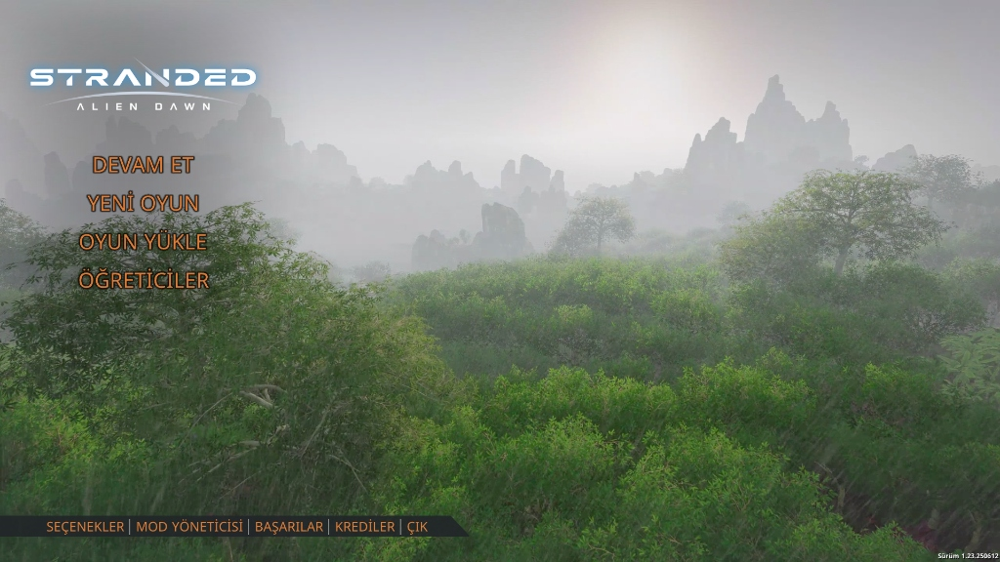
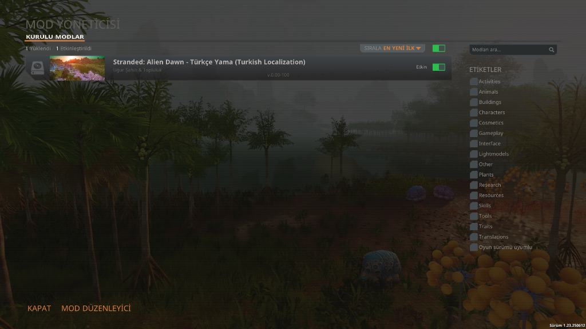
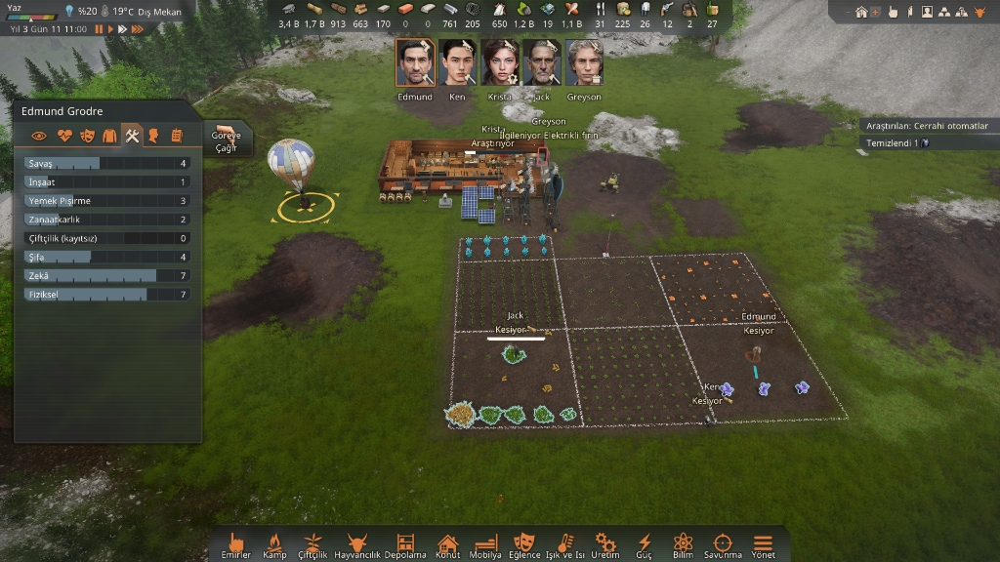
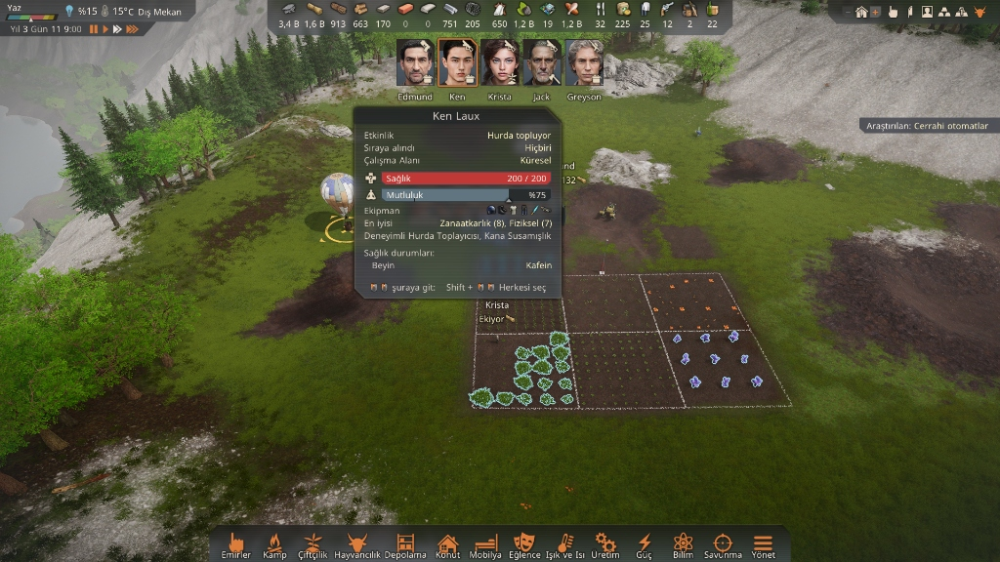
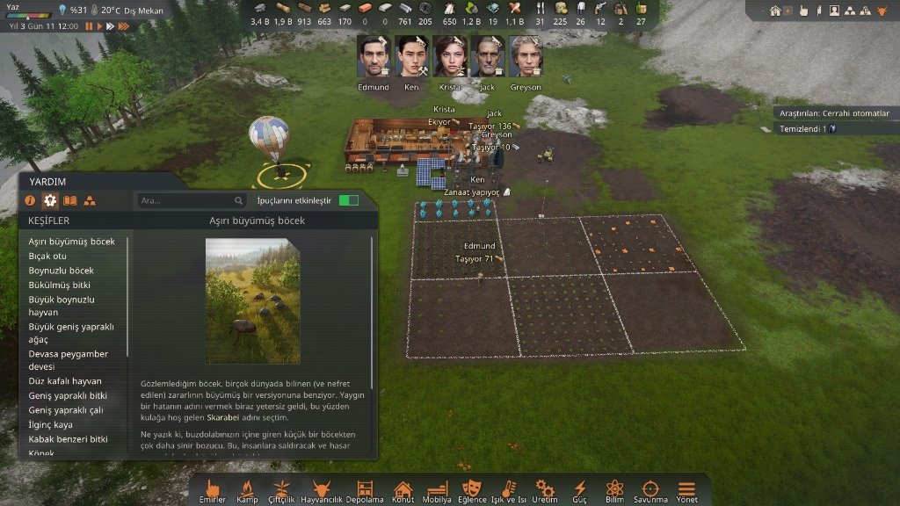

# 🪐 Stranded: Alien Dawn - %100 Türkçe Yama (Mod Paketi)



[]()
[]()
[]()
[]()

Bu depo, bilimkurgu koloni simülasyonu oyunu **Stranded: Alien Dawn** için hazırlanmış **%100 eksiksiz, lore uyumlu ve Türkçe karakter (Noto Sans font) destekli** mod kurulum dosyalarını içerir.

Tüm ana oyun senaryoları, araştırma ağaçları, hayatta kalma hikâyeleri (StoryBits), kurgusal gezegen biyomları ve DLC ek paketleri (Robots and Guardians vb.) dahil **15.495 satır** titizlikle Türkçeleştirilmiştir.

---

## 📸 Oyun İçi Ekran Görüntüleri (Önizleme)

### 1. Ana Menü ve Arayüz


### 2. Mod Yöneticisi (Mod Manager) Görünümü


### 3. Koloni Yönetimi, Yetenekler ve Alt Kontrol Barı


### 4. Kazazede Durum Özeti ve Özellikler


### 5. Keşifler, Flora/Fauna Ansiklopedisi ve Lore Metinleri


---

## 📦 Kurulum Yöntemleri

### Yöntem 1: Tek Tıkla Otomatik Kurulum (Önerilen)
1. Bu sayfadaki yeşil **`Code` ➔ `Download ZIP`** butonuna tıklayın (veya [Releases](https://github.com/ugurtrsahin/Stranded-Alien-Dawn-Turkish/releases) sayfasından son sürümü indirin).
2. İndirdiğiniz zip dosyasını bir klasöre çıkartın.
3. Klasörün içindeki **`Kurulum.bat`** dosyasına çift tıklayın.
4. Dosyalar oyunun yerel mod dizinine otomatik olarak yüklenecektir.

### Yöntem 2: Manuel Kurulum
1. Klavyenizden `Win + R` tuşlarına basarak **Çalıştır** penceresini açın.
2. Açılan kutuya şunu yapıştırıp Enter'a basın:
   ```text
   %APPDATA%\Stranded - Alien Dawn\Mods
   ```
3. Bu klasörün içine `StrandedAlienDawn_Turkish` adında yeni bir klasör oluşturun.
4. İndirdiğiniz tüm dosyaları (`Fonts`, `Localization`, `items.lua`, `metadata.lua`, `preview.png`) bu klasörün içine kopyalayın.

---

## 🎮 Oyunda Aktifleştirme

1. **Stranded: Alien Dawn** oyununu başlatın.
2. Ana menüden **Mod Manager** (Mod Yöneticisi) ekranına girin.
3. **Stranded: Alien Dawn - Türkçe Yama** modunu bulun ve **Enable** (Etkin) seçeneğini işaretleyin.
4. Ayarlar (**Options**) menüsünden oyun dilinin **English** (İngilizce) seçili olduğundan emin olun.
   *(Mod, oyunun resmi İngilizce tablolarını Türkçe ile ezdiği için oyun dili English seçildiğinde otomatik olarak Türkçe açılacaktır).*

---

## 📁 Mod Dosya Yapısı

```text
StrandedAlienDawn_Turkish/
├── Fonts/
│   ├── NotoSans-Regular.ttf      # Türkçe karakter (ğ, Ğ, ş, Ş vb.) destekli Noto Sans yazı tipi
│   └── NotoSans-Bold.ttf         # Noto Sans Kalın yazı tipi
├── Localization/
│   └── Game.csv                  # 15.495 Satırlık Türkçe Yerelleştirme Veritabanı
├── screenshots/                  # Oyun içi ekran görüntüleri
├── items.lua                     # Oyun içi font eşlemeleri ve dil tabloları
├── metadata.lua                  # Mod tanıtım ve sürüm meta verileri
├── preview.png                   # Mod vitrin görseli
├── Kurulum.bat                   # Tek tıkla otomatik kurulum betiği
└── README.md                     # Kurulum ve bilgilendirme kılavuzu
```

---

## ✨ Emeği Geçenler

* **Yerelleştirme & Kalite Güvence:** Uğur Şahin
* **Yazı Tipi:** Noto Sans (Google Fonts)

*İyi oyunlar dilerim!*
